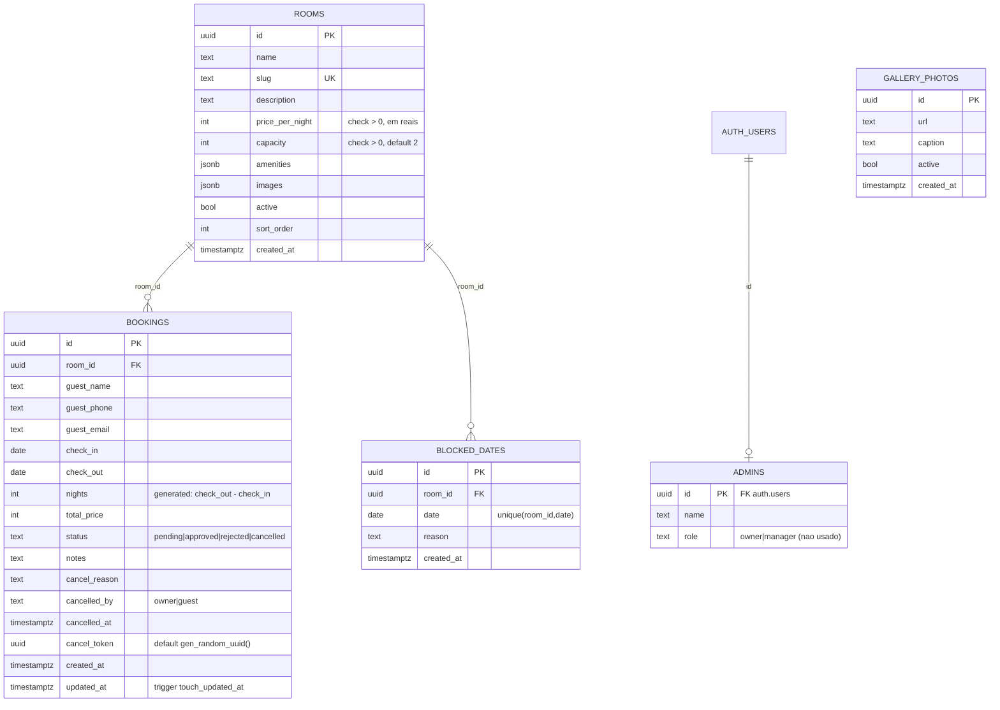

# 02 — Arquitetura: como o sistema funciona

> Baseado em leitura integral do código em 2026-10-29. **[VERIFICADO]** salvo indicação contrária.

## 1. Visão geral

Monólito Next.js 14 (App Router) com três superfícies — site público, painel admin (PWA) e página de autocancelamento do hóspede — sobre um único projeto Supabase. Não há backend próprio além das rotas `app/api/**`; a maior parte da lógica de dados vive no Postgres (RLS, funções SQL, constraint de exclusão).

```mermaid
flowchart LR
  subgraph Browser
    PUB[Site publico<br/>app/(public)]
    ADM[Painel admin PWA<br/>app/(admin)/admin]
    CAN[Cancelamento hospede<br/>app/cancelar/id]
    LOG[Login<br/>app/login]
  end

  subgraph Next.js server
    MW[middleware.ts<br/>sessao em /admin]
    API_PUB[/api/rooms · /api/calendar<br/>/api/bookings · /api/cancel/]
    API_ADM[/api/admin/approve<br/>reject · cancel · block-date/]
    LIB[lib/supabase<br/>client · server · admin<br/>lib/require-admin]
  end

  subgraph Supabase
    PG[(Postgres<br/>rooms · bookings · blocked_dates<br/>admins · gallery_photos<br/>RLS + funcoes + GiST)]
    AUTH[Auth<br/>e-mail/senha]
    ST[Storage<br/>bucket rooms]
    RT[Realtime<br/>bookings]
  end

  PUB --> API_PUB
  ADM --> API_ADM
  ADM -. escrita direta via RLS .-> PG
  ADM -. upload .-> ST
  CAN --> API_PUB
  LOG --> AUTH
  MW --> AUTH
  API_PUB --> LIB --> PG
  API_ADM --> LIB
  RT -. INSERT/UPDATE .-> ADM
```

### Módulos e responsabilidades

| Módulo | Arquivos | Responsabilidade |
|---|---|---|
| Páginas públicas | `app/(public)/page.tsx`, `components/public/*` | Landing (Hero, About, Rooms, Moments, Gallery, Testimonials, Distances, Footer), diálogo de pré-reserva |
| Painel admin | `app/(admin)/admin/{layout,page}.tsx`, `components/admin/*` | Abas Reservas / Calendário / Quartos / Momentos; Realtime |
| Autenticação | `middleware.ts`, `app/login/page.tsx`, `lib/require-admin.ts` | Sessão Supabase + verificação na tabela `admins` |
| API | `app/api/**/route.ts` | Validação zod, cálculo de preço, mudanças de status, bloqueio de datas |
| Acesso a dados | `lib/supabase/client.ts` (browser, anon), `server.ts` (SSR com cookies, anon), `admin.ts` (service role, `server-only`) | Três clientes, três níveis de privilégio |
| Schema | `supabase/schema.sql`, `migration-cancelamento.sql`, `migration-momentos.sql` | Tabelas, funções, RLS, Realtime, Storage, seed |
| Tipos | `types/database.ts` | Interfaces manuais (não geradas) |
| Utilitários | `lib/utils.ts` | `cn`, `brl`, `waLink`, `formatDateBR` |
| PWA/SEO | `public/sw.js`, `public/manifest*.json`, `app/{robots,sitemap}.ts`, JSON-LD em `app/layout.tsx` | Instalável, cache de shell, metadados |

## 2. Fluxo ponta a ponta de uma reserva

```mermaid
sequenceDiagram
  participant H as Hospede (browser)
  participant BF as BookingForm.tsx
  participant CAL as GET /api/calendar
  participant BK as POST /api/bookings
  participant PG as Postgres
  participant RT as Realtime
  participant AD as AdminDashboard / BookingCard
  participant AP as POST /api/admin/approve
  participant WA as WhatsApp (wa.me)

  H->>BF: escolhe quarto (RoomsSection -> BookingDialog)
  BF->>CAL: room_id, start=hoje, end=+6 meses
  CAL->>PG: rpc get_occupied_dates (anon, security definer)
  PG-->>BF: datas ocupadas (aprovadas + bloqueios)
  H->>BF: seleciona intervalo, preenche nome/telefone/e-mail
  BF->>BK: JSON validado por zod
  BK->>PG: select room (service role)
  BK->>PG: rpc is_range_available
  BK->>PG: insert bookings status=pending, total_price=noites x preco
  PG-->>RT: INSERT
  RT-->>AD: nova pre-reserva (flash + vibracao)
  BK-->>H: ok + resumo; botao "Abrir WhatsApp" para o dono
  AD->>AP: booking_id (requireAdmin)
  AP->>PG: update status=approved where status=pending
  Note over PG: constraint no_double_booking (GiST) -> 23P01 se conflito -> 409
  AP-->>AD: approved
  AD->>WA: abre conversa com template + link /cancelar/{id}?t={cancel_token}
```

Arquivos e funções por etapa:

| Etapa | Onde |
|---|---|
| Busca / listagem | `app/(public)/page.tsx:19-26` (SSR, `revalidate=60`), `app/api/rooms/route.ts` |
| Disponibilidade | `components/public/BookingForm.tsx:31-43` → `app/api/calendar/route.ts` → `get_occupied_dates` (`schema.sql:82-101`) |
| Cálculo de tarifa | Cliente: `BookingForm.tsx:58` (só exibição). Servidor (autoritativo): `app/api/bookings/route.ts:74` |
| Reserva | `app/api/bookings/route.ts:18-100` (zod → datas → quarto ativo → `is_range_available` → insert `pending`) |
| **Pagamento** | **Não existe.** `BookingForm.tsx:223`: "Sem pagamento agora." |
| Confirmação | `components/admin/BookingCard.tsx:18-58` → `app/api/admin/approve/route.ts` (guarda `status=pending`; 23P01 → 409) |
| Recusa / cancelamento pelo dono | `app/api/admin/reject/route.ts`, `app/api/admin/cancel/route.ts` (grava `cancelled_by='owner'`, `cancel_reason`, `cancelled_at`) |
| Cancelamento pelo hóspede | `app/cancelar/[id]/page.tsx` (valida id + token com service role) → `CancelClient.tsx` → `app/api/cancel/route.ts` |
| Bloqueio manual | `components/admin/CalendarManager.tsx` → `app/api/admin/block-date/route.ts` (upsert/delete em `blocked_dates`) |
| Notificações | Realtime no painel (`AdminDashboard.tsx:26-45`); mensagens WhatsApp montadas no cliente (`BookingCard.tsx:35-52`, `BookingForm.tsx:92-97`, `CancelClient.tsx:35-39`). Nenhum e-mail/SMS/push. |

## 3. Modelo de dados



Chaves e restrições relevantes (`supabase/schema.sql`):
- `no_double_booking` — `exclude using gist (room_id with =, daterange(check_in, check_out) with &&) where (status = 'approved')` (linhas 41-44). Só reservas **aprovadas** se excluem.
- `valid_range` — `check_out > check_in`.
- Índices: `(room_id, check_in, check_out)`, `(status)`, `(cancel_token)`.
- `rooms.slug` é `unique` **global**.
- Não existe tabela de tenant, propriedade, tipo de quarto, tarifa, política ou pagamento. **Cada linha de `rooms` é uma unidade física reservável** (não há "tipo × quantidade").

## 4. Regras de negócio centrais e onde vivem

| Regra | Implementação | Local |
|---|---|---|
| Disponibilidade | Dia ocupado = reserva `approved` cobrindo o dia **ou** `blocked_dates`. Reservas `pending` **não** bloqueiam. | `get_occupied_dates`, `is_range_available` (`schema.sql:82-122`) |
| Anti-overbooking | Constraint GiST só para `approved`; erro 23P01 vira 409 | `schema.sql:41-44`, `approve/route.ts:25-31` |
| Tarifa | `total = nights × rooms.price_per_night`; inteiro em reais, sem centavos, sem temporada, sem taxa, sem imposto | `bookings/route.ts:74`, `schema.sql:15`, `lib/utils.ts:8` |
| Moeda / locale | BRL e `pt-BR` fixos | `lib/utils.ts:8-9,15`, `app/layout.tsx:78` |
| Limites de estadia | mínimo 1 noite, máximo 60; entrada não pode ser no passado (TZ do servidor) | `bookings/route.ts:32-45` |
| Janela de reserva | hoje + 6 meses | `BookingForm.tsx:33,145`, `CalendarManager.tsx:28,98` |
| Política de cancelamento | Nenhuma: hóspede cancela a qualquer momento com o token; dono cancela `pending` ou `approved` | `api/cancel/route.ts:26`, `api/admin/cancel/route.ts:29` |
| Máquina de estados | `pending → approved` (só de pending); `pending|approved → cancelled`; `reject` sem guarda de estado | `approve:21`, `admin/cancel:29`, `reject:17-22` |
| Check-in/out | 14h / 12h apenas em textos (mensagem WhatsApp, JSON-LD) | `BookingCard.tsx:38-39`, `layout.tsx:72-73` |
| Capacidade | Informativa; nenhum campo de nº de hóspedes na reserva; editor limita a 12 | `RoomEditor.tsx:114` |
| Normalização de telefone | Prefixa `55` se ausente | `BookingCard.tsx:52,86` |
| Uploads | 5 MB, bucket público `rooms` | `RoomEditor.tsx:64`, `MomentsManager.tsx:32` |

## 5. Autenticação, autorização e papéis

- **Autenticação**: Supabase Auth e-mail/senha (`app/login/page.tsx:23`). Sessão em cookies via `@supabase/ssr`.
- **Gate 1** — `middleware.ts` (matcher `/admin/:path*`, `/login`): sem usuário → redirect `/login?next=`.
- **Gate 2** — `app/(admin)/admin/layout.tsx:14` e todas as rotas `app/api/admin/*` chamam `lib/require-admin.ts`, que exige linha em `admins` para `auth.uid()` (policy `admin_read_self`).
- **RLS** (`schema.sql:139-168`): público lê `rooms.active=true` e `gallery_photos.active=true`; admin (`is_admin()`, security definer) tem `for all` em `rooms`, `bookings`, `blocked_dates`, `gallery_photos`; **não há policy de insert público em `bookings`** — a pré-reserva entra pela API com service role.
- **Papéis**: `admins.role` aceita `owner|manager`, mas **nenhum código lê `role`** → um único papel efetivo ("admin").
- **Hóspede**: anônimo; prova de posse da reserva = `cancel_token` (uuid) recebido no WhatsApp.
- **Service role**: só em `lib/supabase/admin.ts` (`server-only`), usada por `api/bookings`, `api/cancel`, `api/admin/*` e pela página `/cancelar/[id]` (server component).

## 6. Integrações externas e acoplamento

| Integração | Como está acoplada | Avaliação |
|---|---|---|
| Supabase | Três fábricas em `lib/supabase/*`; porém `.from()`/`.rpc()`/`.storage` são chamados diretamente em 12 arquivos (rotas, páginas, componentes client) | **Espalhado**: não há camada de repositório. Trocar de BaaS exige tocar em todos. |
| WhatsApp | Templates de texto inline em 4 componentes; `lib/utils.ts:waLink` | Espalhado e com conteúdo do cliente embutido. |
| Google Fonts / Maps / Search Console | `app/layout.tsx`, `Distances.tsx`, arquivo em `public/` | Pontual, fácil de remover. |

## 7. Como rodar, testar e fazer build/deploy (conforme o código revela)

- **Rodar**: instalar dependências → `.env.local` com as 5 variáveis → `npm run dev` (porta 3000). Pré-requisito: projeto Supabase com os 3 SQL aplicados e um admin inserido (`README.md §1-2`).
- **Testar**: não há testes. Só `npm run lint` (sem config) e `npx tsc --noEmit` (sem script).
- **Build**: `npm run build` (precisa de Supabase acessível e internet para Google Fonts).
- **Deploy**: Vercel importando o repo + 5 env vars + domínio (`README.md §3`). Supabase cloud free. Nenhum pipeline.

## 8. Qualidade do código

### Pontos fortes
- Pequeno e coerente (≈2.4k linhas de TS/TSX + 3 SQL); fácil de ler inteiro.
- Decisões de segurança corretas para o porte: preço calculado no servidor, validação zod em todas as rotas, RLS ligado em todas as tabelas, `is_admin()` security definer, service role isolada com `server-only`, constraint GiST contra overbooking, token aleatório para autocancelamento, service worker não cacheia `/api`.
- Separação clara dos três clientes Supabase por nível de privilégio.
- Acessibilidade razoável (aria-labels, `prefers-reduced-motion`, foco visível).

### Dívida técnica
- Zero testes, zero CI, sem lockfile, sem config de ESLint.
- Conteúdo, marca e dados do cliente embutidos em ~20 arquivos (ver `03-acoplamento-ao-cliente-atual.md`).
- Duas vias de escrita no banco: rotas API (service role) **e** escrita direta do browser dependente de RLS (`RoomEditor.tsx:90`, `MomentsManager.tsx:42-64`, leitura em `CalendarManager.tsx:31`). Multi-tenant exigirá revisar cada policy ou centralizar nas rotas.
- Datas com TZ do servidor; `any` em `app/cancelar/[id]/*`; `window.prompt/confirm` no painel; tipos não gerados a partir do schema.
- Service worker cacheia HTML autenticado (`sw.js:25-33`).
- `reject` sem guarda de estado; `approve` devolve 500 para "não pendente".
- `aggregateRating` fixo em JSON-LD.

### Veredito por área

| Área | Veredito | Justificativa |
|---|---|---|
| Schema core (`rooms`, `bookings`, `blocked_dates`, funções, constraint GiST) | **Manter** e estender com dimensão tenant/propriedade | Modelagem correta para o problema; a constraint é o melhor mecanismo possível. Precisa de FK de propriedade e revisão de `slug unique`. |
| Rotas `app/api/**` | **Manter** o padrão (zod → regra → resposta), refatorar para escopo por tenant | Código limpo e previsível; mudanças são locais. |
| `lib/supabase/*`, `lib/require-admin.ts`, `middleware.ts` | **Manter**, estender para resolver tenant | Base sólida; falta só o contexto de tenant. |
| Componentes de reserva (`BookingForm`, `BookingDialog`, `RoomCard`, `RoomsSection`, `CalendarManager`, `BookingCard`, `RoomEditor`) | **Refatorar** | Lógica boa, mas textos, nome do dono, horários e templates WhatsApp estão inline. |
| `lib/utils.ts` (`brl`, `formatDateBR`) | **Refatorar** para moeda/locale parametrizáveis | Trivial, mas usado em todo lugar. |
| Seções de marketing (`Hero`, `About`, `AboutCollage`, `Gallery`, `Testimonials`, `Distances`, `Footer`, `Header`, `WhatsAppFloat`, `MobileBookBar`) | **Reescrever** como conteúdo por tenant (CMS/tabela) | São 100% conteúdo do cliente; a estrutura visual pode servir de template. |
| Metadata/JSON-LD/manifests/sitemap/robots/`sw.js` | **Reescrever** dinâmicos por tenant | Hoje são constantes de build. `sw.js` também por privacidade. |
| `types/database.ts` | **Substituir** por tipos gerados (`supabase gen types`) | Elimina divergência manual. |
| `Momentos` (galeria viva) | **Manter** como feature opcional | Isolada; só precisa de escopo por tenant. |
