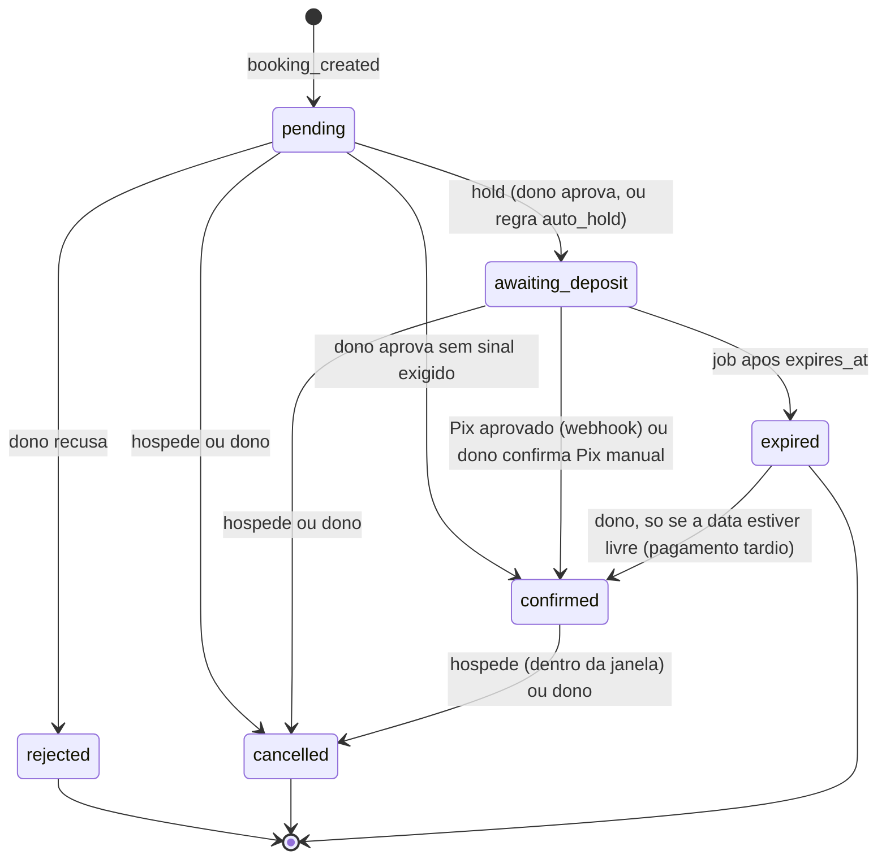
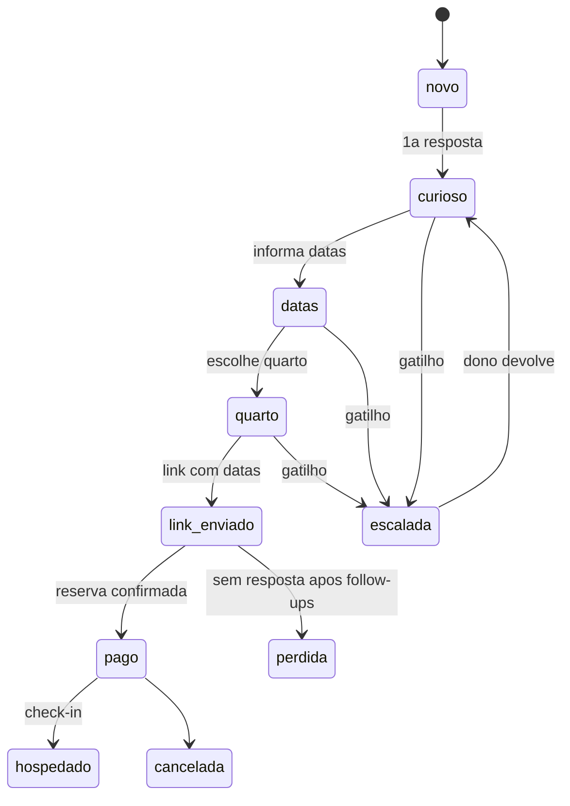

# Hotel Engine — Arquitetura v2 (modelo de resultado)

Camada: Conhecimento (ver `docs/harness.md`). Status: desenho da entrega A-0, 2026-11-01. **Nada aqui foi implementado**: nao ha codigo, SQL nem migracao nesta entrega. Descreve o que construir, em que ordem e com que limites.

Fontes: [strategy v1](strategy/product-strategy-v1.md) (principal), [roadmap do produto](produto-e-roadmap.md), [milestones](milestones.md), [arquitetura atual](analysis/02-arquitetura.md), [schema.sql](../supabase/schema.sql) e `supabase/migrations/*`, rotas `app/api/**`, [BookingCard](../components/admin/BookingCard.tsx), [site-settings](../lib/site-settings.ts), [harness](harness.md) (eixo 4), [pranchas](design/README.md).

Marcadores: `[INCERTO]` = nao verificado; `[INFERIDO]` = deducao a confirmar; **decidido** = decisao do proprietario de 2026-11-01.

---

## 0. Decisoes que este desenho assume

Todas de 2026-11-01, do proprietario. As linhas correspondentes estao em `CLAUDE.md` > Decisoes.

| # | Decisao | Efeito neste documento |
|---|---|---|
| 1 | Modelo hibrido: base por unidade + 5% sobre reservas diretas confirmadas; garantia de 60 dias; preco explicado em comissao economizada | metricas (secao E) e `commercial_terms` |
| 2 | Pilotos T0-T2 em instancia por cliente (1 projeto Supabase + 1 projeto Vercel por pousada); multi-tenant (M2) adiado para T3; D6 reaberta so para o piloto | nenhuma tabela nova leva `tenant_id`; ponto de migracao para T3-A anotado (secao A.0) |
| 3 | 3 pilotos com trafego proprio; `hotel-engine-dev` e a "pousada zero" de desenvolvimento | dev usa sandbox e chaves descartaveis |
| 4 | Gateway Pix: Mercado Pago (link de pagamento + webhook), sandbox primeiro; D7 fechada | secoes A.4, C.1 |
| 5 | WhatsApp semi-automatico em T1 (agente redige, humano envia); API oficial via provedor em T2; D8 ajustada | secoes C.3, D |
| 6 | Posicionamento e outcome principal da strategy secao 5 | secao E |
| 7 | `awaiting_deposit` **bloqueia** a data, com TTL (`expires_at`, ex.: 24 h, configuravel em `booking_policy`); `no_double_booking` cobre `awaiting_deposit` e `confirmed`; `pending` continua sem bloquear; expiracao por job libera a data e gera evento | secao B |
| 8 | `concierge_profile` e `commercial_terms` em tabelas proprias, RLS so admin (fora de `site_settings`, que e publica) | secao A |
| 9 | `webhook_receipts` em tabela propria para idempotencia | secoes A.5, C.1 |
| 10 | Retencao: T1 nao armazena texto de hospede (so `conversations`: estagio, idioma, DDD); T2 retem texto 30 dias com expurgo por job (eventos e metricas ficam); telefone como hash na chave de conversa, em claro so em `bookings` quando ha reserva | secoes A.6, D.6 (conflito registrado em G.2) |
| 11 | Jobs frequentes (iCal 15-30 min, expiracao por hora) nao dependem do Vercel Cron Hobby: padrao `pg_cron` + `pg_net` no Supabase chamando rotas com `CRON_SECRET`; alternativa GitHub Actions `schedule`; Vercel Cron so para o diario | secao C.2 |
| 12 | Decisoes de harness (secao H): agentes em runtime sao codigo de produto; segredos por instancia; excecao para modelo ler texto de hospede; runbook de migracoes em N instancias; webhooks e crons entram na matriz como "API/rota" | secao H e tarefa de aplicacao no milestones |

---

## 1. Principios

1. **O banco continua dono das regras.** Disponibilidade, anti-overbooking, transicoes de estado e politicas vivem no Postgres (como hoje). O TypeScript traduz erros; nao duplica regra.
2. **Todo fato que o hospede le vem do banco; o modelo so redige.** Preco, disponibilidade, politica, foto, comodidade, dica local: de tabelas. O que nao esta cadastrado vira "vou confirmar com a pousada" e escala.
3. **IA so onde ha linguagem.** Confirmar, bloquear, liberar, cobrar, lembrar e medir sao regras e jobs deterministicos. O modelo escreve respostas livres do concierge e a narrativa do relatorio, nada mais.
4. **Toda acao relevante gera evento** (append-only, sem PII). Sem evento, nao ha outcome provavel nem cobranca defensavel.
5. **Dados de hospede minimizados** (LGPD): o minimo em cada tabela, nada em log, nada em prompt alem do necessario, nunca `cancel_token`.
6. **Escrita por um caminho so.** Tabelas novas: leitura admin por RLS; escrita por rota/job/RPC com service role (padrao `app/api/**`). Sem escrita direta do browser (mantem a divida de duas vias de escrita sem aumenta-la).
7. **Instancia por cliente agora, multi-tenant depois.** Nada nesta fase fecha a porta do M2 (secao A.0).

---

## A. Modelo de dados

Convencoes: desenho, nao SQL. Toda tabela nova entra por migracao em `supabase/migrations/` com RLS ligada e policies explicitas na mesma migracao, bloco `-- down:` e funcoes `security definer` com `set search_path = public` (regras de `.claude/rules/dados-e-supabase.md`). Dinheiro novo em **centavos inteiros**.

Padroes de RLS usados abaixo:

| Codigo | Padrao |
|---|---|
| R-adm-sel | `select` so para `is_admin()`; nenhuma policy de insert/update/delete para `authenticated`/`anon`; escrita so por service role (rota, job, RPC) |
| R-adm-all | admin le; escrita por rota `/api/admin/*` com `requireAdmin()` + zod (service role); sem escrita direta do browser |
| R-append | R-adm-sel + trigger que recusa `update` e `delete` |
| R-pub | leitura anon (so para dados publicos por desenho; nunca segredo nem dado de hospede) |

### A.0 Instancia por cliente e o caminho para T3

- Cada piloto e um projeto Supabase + um projeto Vercel proprios. O schema e o mesmo em todas as instancias; o que muda e dado (linha de `site_settings`, quartos, regras).
- `site_settings` segue com linha unica (indice `site_settings_singleton`). `concierge_profile` e `commercial_terms` tambem sao linha unica por instancia, com o mesmo padrao.
- **Ponto de migracao para T3-A:** as tabelas novas ganham `tenant_id` junto com as demais (M2-02) e os indices de linha unica viram unicos por tenant. As tabelas de log (`booking_events`, `webhook_receipts`, `conversation_events`) nao carregam `tenant_id` por conta propria: herdam pela FK (`booking_id`, `conversation_id`); `webhook_receipts` e `job_runs` ganham `tenant_id` em T3-A. Consolidar os dados dos pilotos num so banco e tarefa do T3-A (secao G, risco R-9).
- `schema_version` (A.11) registra a versao aplicada em cada instancia (decisao de harness 4).

### A.1 `booking_events` (nova; fundacao de medicao)

Linha do tempo imutavel de cada reserva.

| Campo | Descricao |
|---|---|
| `id`, `booking_id` (FK), `occurred_at` | chave, reserva, instante (UTC) |
| `actor_type` | `guest`, `owner`, `operator`, `system`, `gateway`, `agent` |
| `actor_id` | uuid do admin (`auth.users`) quando `owner`/`operator`; nulo nos demais |
| `action` | catalogo fechado (abaixo), validado por CHECK |
| `from_status`, `to_status` | nulos quando a acao nao muda estado |
| `origin` | `site`, `admin_panel`, `concierge`, `webhook_mp`, `webhook_wa`, `cron`, `ical`, `db` |
| `request_id` | correlacao com o log da plataforma e com `webhook_receipts` |
| `payload` | jsonb com **allowlist de chaves** (funcao de validacao em CHECK): `payment_id`, `amount_cents`, `rule_id`, `reason_code`, `lint_flags`, `channel`, `response_ms`, `ttl_hours`. Texto livre do hospede **nunca**: `cancel_reason` fica em `bookings`, o evento leva so `reason_code` |

- **RLS:** R-append. **Indices:** `(booking_id, occurred_at)`, `(action, occurred_at)`.
- **Quem escreve:** a funcao `transition_booking` (B.4) e as rotas que criam reserva, sempre na mesma transacao da mudanca de estado; trigger de seguranca em `bookings` grava evento `actor_type='system'`, `origin='db'` se alguem alterar `status` por fora da funcao.
- **Catalogo de acoes (v1):**

| Acao | Quando | Ator tipico |
|---|---|---|
| `booking_created` | insert da pre-reserva | guest / agent |
| `hold_started` | `pending` -> `awaiting_deposit` | owner ou system |
| `payment_link_created` | Pix gerado | system |
| `payment_confirmed` | webhook com valor e referencia conferidos | gateway |
| `booking_confirmed` | -> `confirmed` | gateway, owner |
| `hold_expired` | job libera a data | system |
| `booking_rejected` | `pending` -> `rejected` | owner |
| `booking_cancelled` | -> `cancelled` (com `reason_code`) | guest, owner |
| `payment_after_expiry` | pagamento aprovado apos `expired` | gateway |
| `payment_mismatch` | valor ou referencia nao batem | gateway |
| `no_show_marked` | dono marca no-show | owner |
| `owner_escalated`, `owner_responded` | escalacao e resposta | agent / owner |
| `ical_conflict_detected`, `overbooking_incident` | conflito entre canais; incidente confirmado | system / owner |

### A.2 `bookings` (colunas novas)

| Coluna | Uso |
|---|---|
| `source` | `site`, `concierge`, `ical`, `manual`: **canal tecnico de criacao** |
| `channel` | origem de marketing do primeiro toque, normalizada: `instagram`, `google`, `indicacao`, `whatsapp_entrada`, `booking_ou_airbnb` (hospede que veio da OTA e foi para o direto), `direto`, `desconhecido` |
| `guests` | numero de hospedes (hoje nao existe; necessario para escalar grupo acima da capacidade) |
| `deposit_amount_cents`, `deposit_due_at` (= `expires_at` do hold) | sinal exigido e prazo |
| `expires_at` | fim do hold em `awaiting_deposit` |
| `confirmed_at` | instante de `confirmed` (base das metricas) |
| `no_show_at` | marcacao de no-show (evento + coluna; **nao** e status, para nao ampliar a maquina) `[INFERIDO]` |
| `conversation_id` | opcional, quando a reserva nasce de conversa |

- Valores existentes mantidos (`total_price` em reais inteiros). Convivencia reais x centavos: ver G.1 item 6.
- **RLS:** inalterada (admin tudo; sem insert publico). **Escritor:** `/api/bookings`, `transition_booking`, jobs.

### A.3 `funnel_events` (nova; topo do funil anonimo)

`session_id` (uuid gerado no browser por aba, **sem cookie persistente**), `event_type` (`availability_searched`, `booking_form_opened`, `booking_submitted`), `occurred_at`, `channel`, `nights`, `guests`, `room_id` opcional. Sem IP, sem user agent, sem dado pessoal.

- **RLS:** R-append. **Escritor:** rota publica `POST /api/events` (zod com enum fechado; limite de requisicoes depende do M6-07; ate la, volume e abuso sao risco aceito so no dev e **bloqueiam o go-live do piloto**, ver G.1 item 4). `[INFERIDO]` a rota nao usa service role se o insert passar por funcao `security definer` com `execute` para anon limitada ao enum; decisao de desenho na T0-A.
- A metrica de conversao parte de `availability_searched`. "Visitas" ao site dependem de analytics externo e **nao** entram na v1 `[INCERTO]`.

### A.4 `payments` (nova)

| Campo | Descricao |
|---|---|
| `booking_id`, `kind` | `deposit` (v1); `balance`, `refund` reservados para M4-04 |
| `gateway` (`mercadopago`), `external_id` | unico por gateway |
| `external_reference` | id da reserva, enviado ao gateway e conferido no webhook |
| `amount_cents`, `currency` (`BRL`) | valor exigido |
| `status` | `created`, `pending`, `approved`, `rejected`, `cancelled`, `refunded`, `expired` |
| `checkout_url`, `pix_expires_at` | link e prazo (alinhado a `expires_at` do hold) |
| `idempotency_key` | unico; usado ao criar o link (`booking_id` + tentativa) |
| `paid_at`, `created_at` | |

- **Nao persiste** dados do pagador (nome, CPF, e-mail do gateway) nem qualquer dado de cartao; Pix apenas (D4). Cartao fica fora ate decisao propria; qualquer fluxo de cartao so por tokenizacao do provedor (CLAUDE.md).
- **RLS:** R-adm-sel. **Escritor:** rota que cria o link (service role) e o processamento do webhook (`apply_payment_event`, C.1). **Eventos:** `payment_link_created`, `payment_confirmed`, `payment_mismatch`, `payment_after_expiry`.

### A.5 `webhook_receipts` (nova; idempotencia)

`provider` (`mercadopago`, `whatsapp`), `event_id` (chave estavel **por provedor**, documentada na T1-A/T2-B), `received_at`, `signature_ok`, `processed_at`, `outcome` (`applied`, `duplicate`, `ignored`, `rejected_signature`, `failed`), `error_code`, `payload_hash`, `booking_id` opcional. **Unico** `(provider, event_id)`. **Nao guarda o corpo bruto** (pode ter PII), so o hash e ids.

- **RLS:** R-adm-sel. **Escritor:** as rotas de webhook (C.1). Padrao: inserir primeiro; conflito = duplicado, responder 200 sem reprocessar.

### A.6 `conversations` e `conversation_events` (T1) e `messages` (so T2)

`conversations`: `id`, `phone_hash` (HMAC-SHA256 do telefone normalizado com segredo da instancia, `PHONE_HASH_PEPPER`), `ddd` (2 digitos, extraido **antes** do hash), `language` (`pt`, `es`, `en`, `outro`), `stage`, `stage_changed_at`, `channel`, `booking_id` (opcional), `last_guest_message_at` (janela de 24 h, T2), `escalated_at`, `closed_at`, `created_at`.

- **Estagios:** `novo` -> `curioso` -> `datas` -> `quarto` -> `link_enviado` -> `pago` -> `hospedado`; laterais: `escalada`, `perdida`, `cancelada`.
- `conversation_events`: append-only (`conversation_id`, `action`, `from_stage`, `to_stage`, `actor_type`, `occurred_at`, `payload` allowlist: `lint_flags`, `escalation_reason`, `response_ms`, `model`, `tokens_in`, `tokens_out`, `received_at`, **sem texto**). Acoes: `guest_message_received`, `draft_generated`, `reply_sent`, `followup_due`, `followup_sent`, `escalated`, `faq_proposed`.
- **T1 nao cria `messages`** e nao guarda texto de hospede, nem o rascunho. O operador cola as ultimas mensagens a cada consulta (sem estado) e o numero e usado so para calcular `phone_hash` e `ddd`, depois descartado.
- **T2 cria `messages`:** `conversation_id`, `direction`, `kind` (`livre`, `template`, `sistema`), **`redacted_text`** (texto apos mascaramento, D.6; o original nunca e gravado), `provider_message_id` (unico), `status`, `lint_flags`, `created_at`, `expires_at` (= criacao + 30 dias). Job diario de expurgo apaga as linhas vencidas e **anula `phone_hash`** das conversas sem atividade ha 30 dias `[INFERIDO]: o proprietario decidiu 30 dias para o texto; o prazo do hash e proposta a confirmar`. Estagio, idioma, DDD e eventos permanecem (metricas).
- Ligacao com reserva: em `POST /api/bookings`, se `hash(telefone normalizado)` coincide com conversa aberta, o servidor preenche `conversation_id` nas duas pontas.
- **RLS:** R-adm-sel nas tres. **Escritor:** T1: rota `/api/admin/concierge/*` (operador); T2: webhook do WhatsApp (C.3). Telefone em claro em repouso so existe em `bookings`; veja o conflito com follow-up proativo em G.2.

### A.7 Base de conhecimento do concierge

Todas: **R-adm-all**; o concierge le por funcao de montagem de fatos (D.2), nao por consulta livre do modelo. Todas com `status` (`proposto`, `aprovado`, `arquivado`), `approved_by`, `approved_at`: **o que o concierge usa e so o que um humano aprovou**.

| Tabela | Colunas principais | Observacao |
|---|---|---|
| `hotel_faq` | `title`, `answer`, `keywords[]`, `language`, `source` (`owner`, `operator`, `onboarding_agent`, `pergunta_sem_resposta`) | toda pergunta que o concierge nao soube responder entra como `proposto` (evento `faq_proposed`); sem texto de hospede, so o tema escrito pelo operador |
| `local_tips` | `kind` (`mes`, `evento`, `origem`, `geral`), `month_from`, `month_to`, `event_name`, `origin_region` (lista de DDDs ou regiao), `text`, `language` | escolhida por codigo (datas da estadia x origem); o modelo so reescreve |
| `commercial_rules` | `rule_type` (`max_discount_pct`, `min_nights_for_discount`, `upsell_item`, `late_checkout`), `params` (validados por tipo), `valid_from`, `valid_to`, `active` | definidas pelo dono; fora delas o concierge escala (D.4) |

### A.8 `concierge_profile` e `commercial_terms` (linha unica cada; R-adm-all)

- `concierge_profile`: `tone` (`acolhedor`, `direto`, `descontraido`; escolhido no onboarding), `persona_label` (como o assistente se apresenta; ver G.3, divulgacao de atendimento automatizado), `languages` habilitados, `extra_forbidden_terms` por idioma, `scarcity_threshold` (unidades restantes para poder dizer "ultimas vagas"), `followup_delays` (padrao 2 h e 20 h antes de `expires_at`), `style_notes`. **Fora de `site_settings`**: aquela tabela e lida por anon.
- `commercial_terms`: `base_per_unit_cents`, `variable_pct` (5), `guarantee_days` (60), `guarantee_started_at`, `ota_commission_ref_pct` (declarada pelo dono; base da "comissao economizada"), `billing_fact` (fato gerador do variavel: **decisao comercial aberta**, G.1 item 1), `go_live_at`. Nunca exposta ao hospede.

### A.9 `baselines` e `reports`

- `baselines`: `metric`, `period_start`, `period_end`, `value`, `unit`, `kind` (`baseline`, `periodic`, `operator`), `source` (`declarado_pelo_dono`, `exportacao_da_plataforma_de_reservas`, `painel`, `calculado`), `collected_by`, `note`. Unico `(metric, period_start, period_end, kind)`. **R-adm-all.** Guarda a linha de base dos 30 dias anteriores ao go-live e as medicoes manuais (NPS do dono, horas do operador por semana).
- `reports`: `kind` (`weekly`, `monthly`), `period_start/end`, `metrics` (jsonb agregado, **sem PII**), `narrative` (texto gerado por modelo **so a partir dos agregados**), `status` (`draft`, `approved`, `sent`), `approved_by`, `sent_at`. **R-adm-all.** O operador le e aprova antes de ir ao dono (strategy 5b).

### A.10 `ical_feeds` (T2-A)

`room_id`, `direction` (`import`, `export`), `url` (importacao) ou `token` (exportacao; unico, aleatorio, tratado como segredo), `last_sync_at`, `last_status`, `last_error_code`. **R-adm-all.** Datas importadas entram em `blocked_dates` com origem do feed (coluna nova `feed_id`), nunca como `bookings`. O feed exportado lista `awaiting_deposit` + `confirmed` + bloqueios proprios (**nao** reexporta bloqueios importados, para nao criar laco).

### A.11 `schema_version` e `job_runs`

- `schema_version`: `version` (nome do ultimo arquivo de migracao aplicado), `applied_at`, `applied_by`, `note`. Escrita pelo humano ao aplicar (ultima linha do arquivo de migracao). **R-adm-sel.**
- `job_runs`: `job`, `started_at`, `finished_at`, `status`, `detail` (codigos, sem PII). Alimenta a visibilidade de falha de jobs e o vigia (C.2). **R-adm-sel.**

### A.12 `site_settings` (colunas publicas de politica, via `booking_policy`)

Entram aqui so valores **publicos por desenho**: `confirmation_mode` (`owner_approval`, `auto_hold`), `deposit_required`, `deposit_percent`, `deposit_ttl_hours` (decidido: configuravel; ex. 24). Segredos, termos comerciais e perfil do concierge **nao** entram.

### A.13 Resumo: quem escreve e que eventos nascem

| Tabela | Escritor | Eventos |
|---|---|---|
| `booking_events` | `transition_booking`, `/api/bookings`, jobs, webhooks | (a propria) |
| `funnel_events` | `POST /api/events` | |
| `payments` | rota de link, `apply_payment_event` | `payment_*` |
| `webhook_receipts` | rotas de webhook | |
| `conversations`, `conversation_events` | T1: console do operador; T2: webhook | `guest_message_received`, `escalated`, ... |
| `messages` (T2) | webhook e envio | |
| `hotel_faq`, `local_tips`, `commercial_rules`, `concierge_profile`, `commercial_terms`, `baselines` | rotas admin | evento de auditoria so se o harness decidir (G.1) |
| `reports` | job semanal + aprovacao do operador | |
| `ical_feeds`, `job_runs`, `schema_version` | job / humano | `ical_conflict_detected` |

---

## B. Maquina de estados de `bookings`

Estados: `pending`, `awaiting_deposit`, `confirmed`, `rejected`, `expired`, `cancelled`. (`approved` atual passa a `confirmed`; ver B.5.)



### B.1 Quem bloqueia a data (decidido)

- **Bloqueiam:** `awaiting_deposit` e `confirmed`. `pending`, `rejected`, `expired`, `cancelled` nao bloqueiam.
- `no_double_booking` (GiST) passa a valer `where status in ('awaiting_deposit','confirmed')`. `is_range_available` e `get_occupied_dates` usam o mesmo conjunto (hoje so `approved`).
- **Consequencia no concierge:** "seguro sua data ate amanha" so e dito quando existe reserva em `awaiting_deposit` (o codigo escolhe a frase; o lint recusa a promessa sem hold, D.3).
- **Hold vencido e ainda nao varrido** (a constraint nao pode usar `now()`): antes de tentar um novo hold, a funcao varre os holds vencidos do quarto/periodo (*lazy sweep*) e tenta uma vez; o job por hora e a rede de seguranca. Resultado: nenhuma data presa por mais que o tempo da varredura.

### B.2 Transicoes

| De -> Para | Quem dispara | Guarda no banco | Eventos |
|---|---|---|---|
| (novo) -> `pending` | hospede pelo site; agente nunca cria | `valid_range`; `HE001` (minimo de noites); `source`, `channel` obrigatorios | `booking_created` |
| `pending` -> `awaiting_deposit` | dono (`approve`) ou `system` quando `confirmation_mode='auto_hold'` | `where status='pending'`; constraint cobre sobreposicao (23P01 -> 409); define `expires_at = now() + ttl`, `deposit_amount_cents` | `hold_started`, depois `payment_link_created` |
| `pending` -> `confirmed` | dono, quando `deposit_required=false` | `where status='pending'`; constraint | `booking_confirmed` |
| `pending` -> `rejected` | dono | `where status='pending'` (**guarda nova**: hoje `reject` nao tem) | `booking_rejected` |
| `awaiting_deposit` -> `confirmed` | webhook Pix (`gateway`) ou dono (Pix manual, `reason_code='manual_pix'`) | `where status='awaiting_deposit'`; valor >= sinal, referencia = id da reserva | `payment_confirmed`, `booking_confirmed` |
| `awaiting_deposit` -> `expired` | job / lazy sweep | `where status='awaiting_deposit' and expires_at < now()` | `hold_expired` |
| `awaiting_deposit`/`pending` -> `cancelled` | hospede (token) ou dono | `where status in (...)`; `cancelled_by`, `cancelled_at` | `booking_cancelled` |
| `confirmed` -> `cancelled` | hospede ou dono | janela `HE002` so para o hospede, `cancelled_by='guest'` e estado `confirmed` (era `approved`) | `booking_cancelled` |
| `expired` -> `confirmed` | dono, apos `payment_after_expiry` | constraint (data livre); senao 409 e reembolso e decisao do dono | `booking_confirmed` (`reason_code='late_payment'`) |
| qualquer outra | ninguem | **trigger recusa** (matriz fechada) | — |

### B.3 Pagamento tardio e corridas

- Webhook e job disputam a mesma linha; ambos passam por `transition_booking` com a guarda de estado e bloqueio de linha: um vence, o outro recebe "estado ja mudou".
- Pagamento aprovado com reserva ainda em `awaiting_deposit` (mesmo apos `expires_at`, antes da varredura): **confirma** (o hospede pagou; sem conflito possivel porque o hold ainda ocupa a data).
- Pagamento aprovado com reserva `expired`: grava `payment_after_expiry`, mantem `expired`, **escala ao dono** com contexto; reativar so se a data estiver livre.
- Valor menor que o sinal ou referencia diferente: `payment_mismatch`, nao confirma, escala.

### B.4 Mecanismo: `transition_booking` (RPC) + trigger de matriz

- Rotas e jobs mudam estado **so** por uma funcao `transition_booking(booking_id, to_status, actor_type, actor_id, origin, reason_code, payload)` (`security definer`, `search_path` fixo): trava a linha, confere a matriz, aplica o `update` com a guarda do estado atual, grava `booking_events` e define `expires_at`/`confirmed_at`, tudo numa transacao. Estado e evento nunca divergem.
- Um **trigger `before update of status`** valida a matriz tambem para qualquer escrita que nao venha da funcao (policy `admin_all_bookings` ainda permite update autenticado), gravando evento `origin='db'`. Alternativa descartada: so trigger (o ator nao chega ao trigger com service role sem configuracao de sessao por transacao).
- Tradução de erros mantem o padrao atual: `23P01` -> 409; `HE001`/`HE002` por codigo; novo codigo de transicao invalida (ex. `HE003`) -> 409 `[INFERIDO]`.

### B.5 Como `approve`, `reject` e `cancel` atuais se encaixam

| Rota atual | Hoje | Em v2 |
|---|---|---|
| `POST /api/admin/approve` | `pending` -> `approved`; "nao pendente" vira 500 | `pending` -> `awaiting_deposit` (ou `confirmed` sem sinal) via `transition_booking`; "estado ja mudou" vira **409** (corrige a divida) |
| `POST /api/admin/reject` | sem guarda; aceita `status: rejected|cancelled` | so `pending` -> `rejected`, com guarda; o ramo `cancelled` sai (quem cancela usa `cancel`) |
| `POST /api/admin/cancel` | `pending|approved` -> `cancelled` | `pending|awaiting_deposit|confirmed` -> `cancelled`; evento com `reason_code` |
| `POST /api/cancel` (hospede) | `pending|approved`, janela `HE002` | idem, `HE002` so em `confirmed`; cancelar `pending`/`awaiting_deposit` e livre |
| `POST /api/bookings` | insere `pending` | insere `pending`; se `auto_hold`, chama a transicao para `awaiting_deposit` e cria o link Pix na mesma requisicao |

Divida de `/api/bookings` com o fuso do servidor: resolvida junto (usa o fuso do hotel, como `/api/availability`); ja esta em M2-09.

### B.6 Migracao do vocabulario (expand/contract)

Sem dados reais em nenhuma instancia `[INFERIDO]`, mas o protocolo exige que migracao e consumidores sejam entregas separadas e reversiveis:

1. **Expandir:** aceita `approved` e os novos valores; constraint e funcoes consideram `approved`, `awaiting_deposit`, `confirmed`; cria `transition_booking`, trigger e `booking_events`.
2. **Consumir:** rotas, UI e tipos passam a usar `confirmed` e as novas transicoes.
3. **Contrair:** `approved` -> `confirmed` nos dados, remove `approved` do CHECK e da constraint.

---

## C. Integracoes e jobs

```mermaid
flowchart LR
  subgraph Hospede
    SITE[Site e busca]
    WA[WhatsApp do hospede]
  end
  subgraph Vercel
    API[Rotas /api/*]
    WH[/api/webhooks/mercadopago e /whatsapp/]
    JOB[/api/jobs/*]
    CON[Concierge: console T1, engine T2]
  end
  subgraph Supabase
    DB[(Postgres: bookings, eventos, regras)]
    CRON[pg_cron + pg_net]
  end
  MP[Mercado Pago]
  WP[Provedor WhatsApp]
  SITE --> API --> DB
  API -- cria link Pix --> MP
  MP -- webhook assinado --> WH --> DB
  WA -.T1 humano.-> CON
  WP -- T2 webhook --> WH
  WH --> CON --> WP
  CON --> DB
  CRON -- Bearer CRON_SECRET --> JOB --> DB
  CRON -- SQL direto --> DB
```

### C.1 Webhook de Pix (Mercado Pago)

Rota `POST /api/webhooks/mercadopago` (fora do middleware de sessao admin; usa service role; **o corpo cru** e lido com `req.text()` para verificar a assinatura).

1. **Assinatura:** valida o cabecalho de assinatura do provedor (HMAC com o segredo do webhook da instancia, sobre o manifesto definido na documentacao do gateway) com comparacao em tempo constante. Falha: grava `webhook_receipts` (`rejected_signature`) e responde 401. `[INFERIDO]` o formato exato do manifesto (`id`, `request-id`, `ts`) deve ser conferido na documentacao do gateway na T1-A.
2. **Nao confia no corpo:** usa so o identificador do pagamento e **consulta o pagamento na API do gateway** (token da instancia) para obter status, valor e `external_reference`.
3. **Idempotencia:** insere `webhook_receipts (provider, event_id)` primeiro; conflito = `duplicate`, 200 sem reprocessar.
4. **Aplicacao:** funcao `apply_payment_event(...)` numa transacao: atualiza `payments`, confere valor e referencia, chama `transition_booking` (`gateway`, `webhook_mp`) e grava eventos. Divergencias seguem B.3.
5. **Resposta:** 200 so depois de gravar; falha transitoria devolve 5xx para o gateway tentar de novo (seguro por causa do passo 3). Sem logs com dados de hospede: so ids e codigos.
6. **Reconciliacao:** job a cada 30 min consulta no gateway os pagamentos `created`/`pending` de holds ativos, para cobrir webhook perdido.
7. **Sandbox primeiro:** `hotel-engine-dev` com credenciais de teste do gateway em `.env.local`; piloto so com credenciais reais nas variaveis do projeto Vercel dele (secao H).

### C.2 Jobs (agenda)

Mecanismo padrao (decidido): **`pg_cron` + `pg_net`** no Supabase de cada instancia; o que e SQL puro roda direto no banco; o que precisa do app chama rota `POST /api/jobs/<nome>` com `Authorization: Bearer <CRON_SECRET>` (comparacao em tempo constante; rotas sem cookie). `CRON_SECRET` guardado no Vault do Supabase e nas variaveis da Vercel da mesma instancia. **Alternativa:** GitHub Actions `schedule` (gratis em repositorio publico; `[INFERIDO]` pode atrasar e e desativado apos inatividade do repositorio; exige guardar a URL e o segredo de cada instancia nos secrets do GitHub, **o que contradiz a decisao de segredos por instancia e so entra por excecao registrada**). **Vercel Cron** (plano Hobby: limite diario, poucos jobs `[INFERIDO]`, conferir na documentacao) so para tarefas diarias.

| Job | Frequencia | Onde | O que faz | Idempotencia e eventos |
|---|---|---|---|---|
| `expire_holds` | por hora (+ *lazy sweep*) | **SQL puro** no `pg_cron` | `awaiting_deposit` vencido -> `expired` pela funcao de transicao | evento `hold_expired`; guarda de estado |
| `notify_expired` | apos `expire_holds` | rota (`pg_net`) | avisa hospede/dono (T1: fila para o operador; T2: template) | marca `notified` no evento |
| `reconcile_payments` | 30 min | rota | cobre webhook perdido | por `external_id` |
| `ical_sync` (T2-A) | 15-30 min | rota | importa bloqueios, valida conflito | `ical_conflict_detected` |
| `followups` (T2-B) | 10 min | rota | follow-up de conversa (2 h e `expires_at` - 4 h) dentro da janela de 24 h | `followup_due`/`followup_sent` |
| `purge_messages` (T2-B) | diario | **SQL puro** | apaga `messages` vencidas, anula `phone_hash` antigo | `job_runs` |
| `daily_dispatch` | diario | **Vercel Cron**, uma rota | lembrete de chegada (48 h), keep-alive (leitura simples), relatorio semanal na segunda | `job_runs` |
| `watchdog` | 30 min | SQL no `pg_cron` | olha `job_runs`; job parado alem do esperado dispara alerta ao operador por e-mail (Resend, D8) | falha **visivel** (pendencia M6-01a) |

Notas: o *keep-alive* do plano Free (pausa apos 7 dias) e feito pelo `daily_dispatch` `[INCERTO]` se o proprio `pg_cron` ja conta como atividade; manter o keep-alive de qualquer forma (M6-01a). Cada instancia tem seus proprios jobs e segredos.

### C.3 WhatsApp

- **T1 (semi-automatico):** sem webhook e sem API. O operador usa o **console do concierge** no painel (D.5); o envio e por `wa.me` com o texto do rascunho (como hoje); `reply_sent` e registrado pelo clique do operador. Confirmacoes e lembretes a hospedes saem de **modelos de texto deterministicos** (nao do modelo), tambem por `wa.me`.
- **T2 (API oficial via provedor):** rota `POST /api/webhooks/whatsapp`: valida assinatura HMAC sobre o corpo cru, deduplica por `provider_message_id` em `webhook_receipts`, grava `messages` (texto mascarado) e `conversation_events`, executa o motor do concierge e responde pela API. Status de entrega (enviada/entregue/lida/falha) atualizam `messages.status` de forma idempotente por `(message_id, status)`. Mensagem iniciada pelo negocio **fora da janela de 24 h** so com modelo aprovado pelo provedor `[INFERIDO]`; follow-ups ficam dentro da janela, lembrete de chegada usa modelo. Provedor e numero: decisao aberta (G.1 item 2 e risco R-12).
- Qualquer mensagem que contenha link de cancelamento (com `cancel_token`) e **modelo deterministico**, nunca texto do modelo.

### C.4 Onde o concierge roda

| Fase | Onde | Quem aciona | Segredos |
|---|---|---|---|
| T1 | rota admin `POST /api/admin/concierge/draft` na Vercel da instancia, usada pela pagina `/admin/concierge` | operador logado (`requireAdmin`) | chave do modelo nas variaveis da Vercel da instancia; a maquina de desenvolvimento nunca a ve |
| T2 | mesma funcao de motor, chamada por `/api/webhooks/whatsapp` (serverless) | webhook do provedor | + token do provedor |

---

## D. Concierge

O concierge e **codigo de produto**, nao agente de desenvolvimento (decisao de harness 1). Nao tem shell, nao le segredos, nao chama ferramentas: o codigo orquestra e o modelo so le texto e escreve texto.

### D.1 Capacidade x fonte de verdade

| Capacidade | Fonte | Quem produz o fato |
|---|---|---|
| Disponibilidade e preco | funcao compartilhada extraida de `/api/availability` (mesmas funcoes SQL); total = noites x preco do banco | codigo |
| Fotos do quarto | `rooms.images` (Storage) | codigo escolhe 2-3 |
| Politicas (entrada/saida, minimo de noites, cancelamento, sinal) | `site_settings` / `booking_policy` | codigo |
| Duvidas (cafe, pet, estacionamento) | `hotel_faq` aprovado, `rooms.amenities` | codigo busca; modelo reescreve |
| Dicas locais | `local_tips` por mes/evento/origem (DDD) | codigo escolhe; modelo reescreve |
| Negociar (desconto, upsell) | `commercial_rules` | codigo valida o limite |
| Link de reserva | construido pelo codigo com datas/quarto/`channel` (**nunca** pelo modelo) | codigo; pre-preenchimento do formulario por parametros `[INCERTO]`: a busca atual nao foi verificada quanto a isso, vira tarefa na T1-B |
| Estagio do funil e follow-up | `conversations` + eventos | codigo |

### D.2 Pipeline (duas chamadas, sem ferramentas)

1. **Mascarar** o texto do hospede (D.6).
2. **Extracao** (chamada 1, saida JSON validada por zod): intencao, datas, hospedes, quarto desejado, idioma, ocasiao, `needs_owner`, suspeita de injecao. Datas validas e dentro da janela, ou descartadas.
3. **Fatos** (codigo): monta o pacote de fatos so com o que esta cadastrado e aprovado, calculando disponibilidade, total, fotos, FAQ/dicas/regras aplicaveis e a flag de escassez (`unidades restantes <= scarcity_threshold`).
4. **Redacao** (chamada 2): recebe perfil (tom, idioma), estagio, fatos e a pergunta mascarada; devolve JSON `{partes[], estagio_proximo, precisa_dono, fatos_usados[]}`.
5. **Lint** (codigo, deterministico, D.3). Reprova: regenera uma vez; reprovou de novo: **nao envia**, escala com o rascunho marcado.
6. **Saida:** T1 devolve o rascunho ao operador; T2 envia.

O texto do hospede e **dado nao confiavel**: entra delimitado, nunca como instrucao; a saida e JSON restrito; sem ferramentas; o prompt nao contem segredo algum. Indicios de injecao (pedido para ignorar regras, revelar instrucoes) marcam `precisa_dono`, gravam `lint_flags` e escalam.

### D.3 Lint de saida (regras)

- Todo numero da resposta (preco, total, datas, quantidades, horarios) precisa constar no pacote de fatos.
- Escassez ("ultimas unidades") so com a flag de escassez verdadeira; prova social, avaliacao e desconto inventados sao proibidos (lei do consumidor).
- "Seguro sua data" so se houver reserva `awaiting_deposit` ativa; o prazo citado e o de `expires_at`.
- Glossario proibido (secao D.7), por idioma.
- Sem URL fora do dominio do hotel e do link construido pelo codigo; sem telefone, e-mail ou `cancel_token`.
- Idioma da resposta = idioma detectado; mensagens curtas, uma informacao por vez.

### D.4 Limites de poder

| Pode | Nao pode |
|---|---|
| Ler disponibilidade e preco pelas funcoes publicas | Criar, alterar, aprovar ou cancelar reserva (quem cria e o fluxo do site com link e Pix) |
| Escrever `conversations` e `conversation_events` (e `messages` em T2) por modulo unico com lista fechada de operacoes | Ler ou escrever `bookings` com dados de hospede, `payments`, `commercial_terms` |
| Propor item de FAQ (`proposto`) | Aprovar conteudo, alterar regra ou preco |
| Oferecer desconto/upsell **dentro** de `commercial_rules` | Prometer o que nao esta cadastrado, nem desconto fora de regra |
| Escalar ao dono | Responder reclamacao, pedido de grupo acima da capacidade, assunto juridico ou de seguranca |

### D.5 Maquina de estados da conversa e escalacao



- **Follow-ups** (regras por estagio, codigo): em `link_enviado`, 2 h depois e **4 h antes do fim do hold** (20 h, com TTL de 24 h), cada um com motivo verdadeiro; limite de dois. Em T1 aparecem como lista "follow-ups vencidos" no console; em T2 saem sozinhos dentro da janela de 24 h.
- **Gatilhos de escalacao** (enum em `payload.escalation_reason`): `reclamacao`, `grupo_acima_da_capacidade`, `pergunta_sem_resposta`, `desconto_fora_da_regra`, `pedido_cancelamento_tardio`, `problema_de_pagamento`, `baixa_confianca`, `lint_reprovado`, `pediu_humano`, `suspeita_de_injecao`.
- **Escalacao:** nunca deixa o hospede sem resposta (mensagem curta "vou confirmar com a pousada e ja volto") e envia ao dono um resumo de uma frase (sem dados alem do necessario) com acoes rapidas. `pergunta_sem_resposta` gera `faq_proposed`.
- **Console do operador (T1):** pagina `/admin/concierge`: campo de telefone (so para hash e DDD, descartado), area para colar as ultimas mensagens, estagio, botao "Gerar rascunho", resultado com avisos do lint, "Abrir no WhatsApp", "Escalar", lista de follow-ups vencidos e de perguntas sem resposta. Nada de texto do hospede e gravado.

### D.6 O que vai ao modelo e o que fica no banco (LGPD)

| Dado | Vai ao modelo? | Fica no banco? |
|---|---|---|
| Texto do hospede | **sim, mascarado** | T1: nao; T2: so `redacted_text`, 30 dias |
| Telefone, e-mail, CPF/CNPJ, numeros com cara de cartao digitados no chat | **nunca** (mascarados antes; sequencias de 13 a 19 digitos sao sempre mascaradas) | telefone: so `phone_hash` + `ddd` em `conversations`; claro apenas em `bookings` |
| Nome do hospede | opcional, so o primeiro nome, se o dono liberar no perfil | `bookings.guest_name` quando ha reserva |
| `cancel_token` | nunca | so em `bookings`; links com token saem de modelos deterministicos |
| Fatos do hotel (quartos, precos, politicas) | sim | sim (publicos) |
| Agregados do relatorio | sim (sem PII) | `reports` |

- Provedor do modelo: contrato de **nao treinamento e retencao zero** (API da Anthropic) com minimizacao acima; base legal documentada: **legitimo interesse** para atendimento, **consentimento** para marketing. Lista do que falta para o juridico: G.3. Esta secao descreve minimizacao tecnica; **nao e parecer juridico**.

### D.7 Regras de linguagem e glossario proibido (strategy 2.6b)

Regras (viram especificacao do prompt-contrato e checagens do lint): palavras do hospede, nao do setor; mensagens curtas, uma informacao por vez, numeros redondos; regionalizar por DDD, cidade citada e idioma; responder no idioma da mensagem (pt, es, en); sazonalidade concreta ("em janeiro a cidade enche e os quartos acabam cedo"); tom por hotel (`concierge_profile.tone`); comparacao honesta ("no Booking esse quarto esta saindo mais caro" so se a regra comercial e o dono autorizarem e houver fato cadastrado).

**Glossario proibido** (strategy 2.6b item 7), em pt, com equivalentes por idioma em `extra_forbidden_terms`: `OTA` (use "Booking" e "Airbnb" pelo nome), `tenant`, `policy`, `check-in`/`check-out` em ingles (use "horario de entrada" e "de saida"), `deposit` (use "sinal"), `alta temporada` (use "epoca de feriado" ou o mes). **Proposta a confirmar** `[INFERIDO]`: tambem `overbooking`, `no-show`, `lead`, `funil`, `conversao` e `inventario` dirigidos ao hospede.

---

## E. Metricas

Fonte unica: `booking_events`, `conversation_events`, `funnel_events`, `bookings`, `payments`, `baselines`. Fuso: o do hotel (`site_settings.timezone`). Tudo por instancia (por piloto), agregavel depois.

### E.1 Atribuicao (regra comum)

Uma reserva e **atribuida ao sistema** quando `source in ('site','concierge')` **e** existe `payments` aprovado do sinal (prova independente) **e** o `channel` de primeiro toque nao e `desconhecido` por falha de captura. Reserva `manual` (dono) e `ical` (OTA) nunca sao atribuidas. Disputa "viria de qualquer jeito": o relatorio traz a abertura por `channel`; o contrato (decisao comercial, G.1 item 1) define se `direto` e `indicacao` cobram variavel.

### E.2 Definicoes

| Metrica (strategy 2.7) | Definicao exata |
|---|---|
| Reservas diretas confirmadas / mes | contagem de `bookings` atribuidos com `confirmed_at` no mes, e `status` atual em `confirmed` na data de fechamento. As canceladas depois entram em linha separada ("confirmadas e depois canceladas") |
| Comissao economizada (R$) | soma de `total_price` das reservas acima x `commercial_terms.ota_commission_ref_pct`. E **estimativa** ancorada na comissao declarada pelo dono |
| Tempo de 1a resposta | mediana, por conversa, de `reply_sent` (ou envio T2) menos `guest_message_received`. **T1:** o instante da mensagem e digitado pelo operador (`received_at`) e o de envio e o clique; mede a rapidez do operador, nao a do concierge. **A meta de menos de 2 min nao e comprovavel em T1; so em T2 (timestamps do provedor)** |
| Conversao | site: `availability_searched` -> `booking_submitted` -> `payment_confirmed` por sessao e por `channel`. Conversa: `curioso` -> `link_enviado` -> `pago`, por idioma e por DDD. Os dois lados sempre com o tempo de resposta ao lado |
| No-show e cancelamento tardio | no-show = `no_show_marked` / confirmadas com `check_in` no periodo. Cancelamento tardio = `booking_cancelled` de `confirmed` com `cancelled_at` dentro de `cancellation_free_days` antes do `check_in`. Comparar com a linha de base (pre-sinal) |
| Incidentes de overbooking | contagem de `overbooking_incident` (confirmado pelo dono). `ical_conflict_detected` e alerta, nao incidente. Meta: zero. Dentro de um canal a constraint impede; entre canais so o iCal (T2-A) cobre |
| Horas devolvidas ao dono | conversas **resolvidas sem dono** (sem `escalated` e com estagio >= `link_enviado` ou encerradas) x minutos medios por conversa declarados na linha de base. **Estimativa** declarada como tal |
| Escalacao ao dono | % de conversas com `escalated`, semana a semana (criterio de sucesso da strategy 2.12) |
| Receita variavel x custo de operacao | `variable_pct` x total atribuido, contra horas do operador (`baselines kind='operator'`) |
| Linha de base | os mesmos numeros nos 30 dias antes do go-live (abaixo) |

### E.3 Linha de base

- **O que:** reservas e origem (declarada), comissao paga, mensagens por dia, tempo medio de resposta declarado, minutos por conversa, no-shows e cancelamentos tardios dos 30 dias anteriores.
- **Como e coletada:** na reuniao de implantacao, com o dono; dados da plataforma de reservas por exportacao quando existirem; registrada em `baselines` (`kind='baseline'`, `source` explicito) por quem coleta. **Sem linha de base nao ha outcome, so numero bonito** (strategy 2.7).
- **Honestidade:** valores declarados pelo dono sao `declarado_pelo_dono` e aparecem com essa etiqueta no relatorio.
- **Fechamento mensal do variavel:** a partir de `booking_events` e `payments`; o fato gerador (confirmacao x estadia concluida) e estorno de cancelamento sao decisao comercial aberta (G.1 item 1).

---

## F. Codigo atual: reaproveitar, adaptar, remover

| Item | Acao | O que muda | Pranchas (`docs/design`) |
|---|---|---|---|
| `supabase/schema.sql`, `migration-*.sql` | reaproveitar | historico, nao editar; tudo entra por `supabase/migrations/` | — |
| Funcoes `is_range_available`, `get_occupied_dates`, constraint `no_double_booking` | **adaptar** (migracao) | conjunto bloqueante `awaiting_deposit` + `confirmed` (B.1) | Site-Busca (sem mudanca visual) |
| Trigger `enforce_booking_policy` (HE001/HE002) | adaptar | `HE002` passa a `confirmed`; novo codigo de transicao | Site-MinhaReserva (mensagem) |
| `app/api/bookings/route.ts` | **adaptar** | `source`, `channel`, `guests`, evento, `auto_hold`, fuso do hotel; mantem preco no servidor e service role | Site-Reserva (passo 3 vira Pix) |
| `app/api/admin/approve` | adaptar | vira `transition_booking`; "ja mudou" = 409 | Painel-Reservas |
| `app/api/admin/reject` | adaptar | guarda `pending`; sai o ramo `cancelled` | Painel-Reservas |
| `app/api/admin/cancel`, `app/api/cancel` | adaptar | novos estados, `reason_code` | Painel-Reservas, Site-MinhaReserva |
| `app/api/availability`, `app/api/calendar` | reaproveitar | extrair a logica de `/api/availability` para funcao compartilhada usada tambem pelo concierge | Site-Busca |
| `app/api/admin/block-date` | reaproveitar | passa a registrar `feed_id` em T2-A | Painel-Calendario (adiado) |
| `components/admin/BookingCard.tsx` | **adaptar** | rotulos dos novos estados; acoes de excecao (confirmar Pix manual, marcar no-show); **sai** `window.prompt/confirm` (divida; fluxo da gaveta, M4-06 reduzido); os textos de WhatsApp saem do componente e vao para modulo de modelos de texto (servidor/compartilhado) | Painel-Reservas |
| `components/public/BookingForm.tsx` e fluxo do hospede | adaptar | captura de `channel`, evento `booking_submitted`, tela de Pix e contagem regressiva; o texto "Sem pagamento agora" muda | Site-Reserva |
| `app/cancelar/[id]/*` | adaptar | textos e estados (nao ha reembolso na v1: M4-04 adiado) | Site-MinhaReserva |
| `lib/site-settings.ts`, `site_settings` | reaproveitar | segue publica; recebe so as colunas publicas de politica (A.12) | Painel-Config (Politicas: sinal) |
| `lib/utils.ts` (`waLink`, `brl`) | reaproveitar | `waLink` segue em T1; centavos exigem formatador novo | — |
| `public/sw.js` | adaptar | M1-12 antes do 1o deploy publico | — |
| `lib/supabase/*`, `lib/require-admin.ts`, `middleware.ts` | reaproveitar | `/api/jobs/*` e `/api/webhooks/*` ficam **fora** da sessao admin e dentro das regras de seguranca (secao H) | — |
| Seed e galeria "Momentos"/"Galeria do hotel" | rebaixar | feature generica (M1-10) vai para "Adiado"; vira "fotos do hotel" no onboarding | Main |
| Tema/cores, dominio proprio, equipe/papeis, tape chart, painel Hoje | **adiar** | secao "Adiado" do milestones | Painel-Calendario, Painel-Hoje, Painel-Config (Equipe) congeladas |
| **Novo:** painel **Resultado** (entrada do `/admin`), console do concierge, secoes Concierge/Pagamentos em Configuracoes | criar | nao ha prancha | **a desenhar no canvas pelo proprietario** (Painel-Resultado, Painel-Concierge); sem prancha, a tarefa de UI para (criterio visual de pronto do `revisor`) |

Impacto resumido nas pranchas: Site-Busca, Main e Painel-Config (exceto Equipe) mudam pouco; Site-Reserva, Site-MinhaReserva e Painel-Reservas mudam de conteudo; Painel-Hoje e Painel-Calendario ficam congeladas; duas pranchas novas sao necessarias.

---

## G. Riscos e decisoes em aberto

Esta secao lista; **nao decide**. O que o proprietario ja decidiu esta na secao 0.

### G.1 Decisoes em aberto

| # | Decisao | Por que importa | Gate |
|---|---|---|---|
| 1 | Fato gerador do variavel (confirmacao x estadia concluida), estorno em cancelamento, se `direto`/`indicacao` cobram | atribuicao contestada e fechamento mensal | negocio, antes do 1o fechamento (T0-A) |
| 2 | Provedor de WhatsApp (API oficial direta x intermediario), custo, aprovacao de modelos | T2-B | T2-B |
| 3 | `deposit_percent` padrao, retencao do sinal em no-show e cancelamento tardio, reembolso | nao ha reembolso na v1 (M4-04 adiado); regra deve ser clara antes do 1o sinal real | T1-A |
| 4 | Mitigacao de "segurar data sem pagar" (limite de holds por telefone/IP, captcha, sinal minimo) e rate limit das rotas publicas | `auto_hold` bloqueia datas; sem M6-07 e abuso trivial | **M6-07 minimo antes de `auto_hold` num piloto** |
| 5 | Expiracao de `pending` sem resposta do dono (hoje nao expira) | dona que nao responde mantem lixo; opcional | T1-A |
| 6 | Reais inteiros em `bookings` x centavos em `payments` | arredondamento e conferencia de valor | T1-A (ou na tarifacao) |
| 7 | Eventos de auditoria das edicoes de FAQ/regras/termos | quem mudou o que influencia o concierge | T1-B |
| 8 | Role dedicada de Postgres para o modulo do concierge (em vez de service role em modulo unico) | menor privilegio | T2-B |

### G.2 Conflitos encontrados ao aplicar as decisoes

1. **Telefone so como hash x follow-up proativo em T2.** O hash impede enviar mensagem depois: o numero chega no webhook, mas follow-up em 2 h/20 h ocorre em outra requisicao. Opcoes: (i) guardar o numero **cifrado** (chave no Vault) so durante a janela e expurgar com as mensagens (30 dias); (ii) nao fazer follow-up proativo em T2; (iii) usar identificador de contato do provedor `[INCERTO]` se existir. **Recomendacao:** (i). Aguarda decisao; em T1 nao ha conflito (operador envia). Nao decidido aqui.
2. **Hash tambem e dado pessoal.** Pseudonimizacao nao e anonimizacao; por isso o desenho anula `phone_hash` apos 30 dias de inatividade `[INFERIDO]`. Confirmar prazo.

### G.3 Pendencias para o juridico (nao decidir por ele)

- Base legal: legitimo interesse (atendimento) e consentimento (marketing): redacao, registro e como o hospede opta por sair.
- Papel de cada parte: o hotel como controlador e a Hotel Engine como operadora: contrato de tratamento de dados com cada piloto, e acesso do operador aos dados de hospede de 3 clientes.
- Contrato do provedor do modelo: nao treinamento e **retencao zero**; elegibilidade, regiao de processamento e transferencia internacional `[INCERTO]`.
- Divulgacao de atendimento automatizado (identificar o assistente) e politica de privacidade do site.
- Retencao e expurgo (30 dias do texto; prazo do hash), pedidos de eliminacao do titular.
- Sinal: direito de arrependimento em compra a distancia e retencao do sinal em cancelamento (`[INCERTO]` aplicacao a hospedagem).
- Gateway de pagamento: Pix apenas, **sem dado de cartao** em nenhuma tabela; fluxo de cartao, se vier, so por tokenizacao do provedor e analise de escopo de PCI antes.

### G.4 Riscos

| # | Risco | Mitigacao proposta |
|---|---|---|
| R-1 | Hold sem pagamento prende datas | G.1 item 4; TTL curto; limite por telefone |
| R-2 | Webhook perdido ou duplicado | idempotencia por `webhook_receipts`; reconciliacao a cada 30 min |
| R-3 | Job parado em silencio | `job_runs` + vigia + alerta por e-mail (falha visivel) |
| R-4 | Deriva de schema entre instancias | `schema_version`, runbook em ordem (dev -> piloto 1 -> 2 -> 3), checklist por instancia; o humano aplica |
| R-5 | Supabase Free pausa em 7 dias sem uso | keep-alive por instancia; dump semanal por instancia (M6-01a/b) |
| R-6 | Texto de hospede em prompt | secao D.6; minimizacao; excecao registrada no harness |
| R-7 | Injecao de prompt pelo hospede | secao D.2: sem ferramentas, JSON restrito, lint, escalacao |
| R-8 | Vercel Hobby: limite de cron e de tempo de funcao | `daily_dispatch` unico; trabalho pesado fora do cron diario `[INFERIDO]` |
| R-9 | Migrar instancias para multi-tenant (T3-A) | desenho com mesma forma de schema; plano de consolidacao e tarefa propria |
| R-10 | Tempo de 1a resposta nao comprovavel em T1 | declarado em E.2; comprova em T2 |
| R-11 | "Concierge vira agencia" (horas do operador nao caem) | metrica de horas por cliente por semana, revisada a cada fase |
| R-12 | Numero de WhatsApp em API oficial pode deixar de funcionar no aplicativo do dono | decidir numero do concierge x numero do hotel antes de T2-B `[INCERTO]` |
| R-13 | Dono e hospede veem estados novos em telas sem prancha | pranchas novas antes das tarefas de UI (F) |

---

## H. Harness: texto proposto (decisao 12)

A mudanca em `docs/harness.md` **nao** e feita nesta entrega (A-0 e so documentos de produto; mexer no harness pede entrega propria, com `evals/sessao-zero` rodado depois, conforme o milestones). Este e o texto a aplicar na tarefa **T0-B**.

1. **Nova secao "Agentes em runtime"** (separada do eixo 1, que trata de agentes de desenvolvimento). Principios: sao codigo de produto; sem shell e sem ferramentas de escrita; sem acesso a segredos (o modelo nunca recebe chave nem token); so rotas internas e modulos com menor privilegio (le disponibilidade; escreve apenas `conversations`/`conversation_events`, e `messages` em T2, por modulo com lista fechada de operacoes e validacao); toda acao gera evento; a saida passa por lint deterministico (glossario, numeros so dos fatos); **o `revisor` e obrigatorio em qualquer mudanca de prompt-contrato ou de poder**.
2. **Segredos por instancia:** `MERCADOPAGO_ACCESS_TOKEN`, `MERCADOPAGO_WEBHOOK_SECRET`, token e segredo do provedor de WhatsApp, `CONCIERGE_LLM_API_KEY`, `CRON_SECRET`, `PHONE_HASH_PEPPER` vivem so nas variaveis da Vercel e do Supabase (Vault) de **cada** projeto. O principio "a maquina do agente nunca guarda segredo de producao" continua; a instancia dev ("pousada zero") usa sandbox e chaves descartaveis em `.env.local`. Lista de **nomes** em `.env.example`; valores nunca.
3. **Excecao registrada para modelo ler texto de hospede** (a tabela de memoria diz "dados de hospede: nenhum lugar"): somente texto mascarado (telefone, e-mail, CPF/CNPJ, numeros de cartao), nunca `cancel_token`; provedor com nao treinamento e retencao zero; base legal documentada; pendencias do juridico em G.3.
4. **Migracoes em N instancias:** runbook com ordem (dev -> piloto 1 -> 2 -> 3), checklist por instancia e `schema_version`; o humano aplica (a regra de nao aplicar migracao continua); T3-A planeja a consolidacao.
5. **Webhooks e crons como superficies novas:** entram na matriz de validacoes do milestones como "API/rotas" com `revisor` obrigatorio e **teste de assinatura e de idempotencia** (assinatura invalida recusada; mesmo evento duas vezes aplica uma).

---

## Apendice: ordem de construcao (resumo; detalhe em `docs/milestones.md`)

T0-A medicao (`booking_events`, `source`/`channel`, linha de base) -> T0-B harness -> T1-A pagamento e confirmacao -> T1-B concierge semi-automatico -> T1-C relatorio e painel Resultado -> T2-A iCal -> T2-B WhatsApp API -> T2-C precificacao e go/no-go -> T3-A multi-tenant -> T3-B onboarding por agente. E0-B1 (upgrade), M1-12 (`sw.js`) e a producao segura seguem como entregas proprias.
