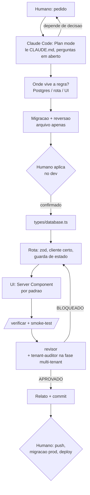
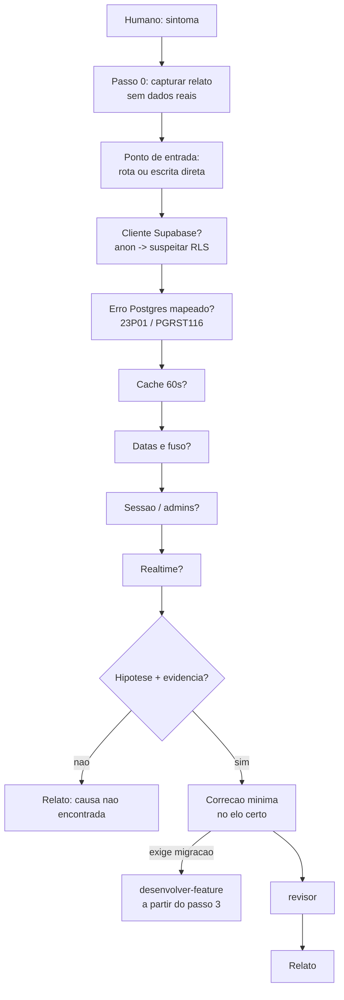
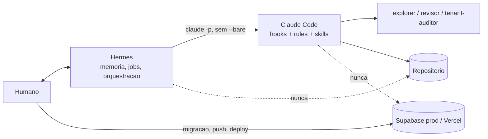

# Harness do projeto

Porta de entrada para qualquer agente (Claude Code, subagentes, Hermes) e para humanos.
Define quem faz o que, com que poder, o que vale mais quando duas regras discordam,
e como provar que tudo isso funciona.

Convencao: itens marcados **[FALTA]** ainda nao existem; a prioridade (P1 > P2 > P3) diz a ordem de criacao.

## Resumo em 12 linhas (leia isto se nao for ler o resto)

- Precedencia quando regras discordam: hook > rule > skill > prompt do humano > preferencia do modelo (secao 0).
- Quem edita o repo: entre os agentes, so o Claude Code. Quem revisa: `revisor` (e `tenant-auditor` na fase multi-tenant). Quem so le: `explorer` (eixo 1, matriz de poder).
- Hermes = memoria entre sessoes e orquestrador, configurado em `.hermes.md`; nunca edita o repo; nunca chama `claude` com `--bare` (eixo 1, matriz de poder; eixo 5, posicao do Hermes).
- Proibido para qualquer agente: `git push`, `supabase db push` / `migration up --linked`, `psql` remoto, `vercel --prod` ou deploy, ler `.env*` alem do `.env.example`, editar `supabase/schema.sql` e os `migration-*.sql` historicos, policy `using (true)`, desligar RLS (eixo 4, matriz de aprovacao; hooks `validate-bash.js` e `post-edit.js`; rules `verificacao-e-git.md` e `dados-e-supabase.md`).
- Pede confirmacao ao humano: abrir PR (o `git push` em si e do humano; o hook bloqueia), dependencia nova, gravar memoria (Hermes), criar skill ou rule (eixo 4, matriz de aprovacao).
- Humano e quem aplica migracao (no projeto `hotel-engine-dev`, depois no prod), faz push e deploy (eixo 1, matriz de poder; eixo 3, caminho para producao).
- Tres clientes Supabase: `lib/supabase/client.ts` (anon, browser), `server.ts` (anon + cookies, SSR), `admin.ts` (service role; so em `app/api/**/route.ts` ou Server Component que precisa ler sem sessao, ex.: `app/cancelar/[id]/page.tsx`) (`.claude/rules/dados-e-supabase.md`; `CLAUDE.md` §3).
- Pronto = `/verificar` passa + migracao (se houver) aplicada no dev e confirmada pelo humano + `types/database.ts` atualizado + `revisor` sem apontamento bloqueante + relato entregue (eixo 3, contrato de "pronto").
- Ambientes: dev = `hotel-engine-dev` (sa-east-1, plano Free, pausa apos 7 dias sem uso); prod ainda nao configurado (placeholders em `CLAUDE.md` §9); nenhum deploy ate o upgrade de next/zod (`CLAUDE.md` §9 e Decisoes).

---

## 0. Precedencia (vale para tudo)

Quando duas instrucoes discordam, a de cima ganha e a de baixo e corrigida:

1. **Hooks** (`.claude/hooks/*`) — codigo deterministico; nao depende de obediencia.
2. **Rules** (`.claude/rules/*.md`) — invariantes do dominio.
3. **Skills** (`.claude/skills/*/SKILL.md`) — procedimentos.
4. **Prompt do humano na sessao.**
5. **Preferencia do modelo.**

Hermes (`.hermes.md`) fica fora desta cadeia: ele nao edita o repositorio, so delega ao Claude Code, que carrega 1-3.

Toda regra mora em exatamente um lugar. Skills e agentes apontam para rules; nunca reescrevem.
Se uma regra e violada duas vezes, ela desce de camada (rule -> hook).
Se um hook bloqueia caso legitimo repetidamente, ele sobe (hook -> rule com contexto).

---

## Mapa de camadas

| Dimensao | Pergunta que responde | Camada | Arquivos |
|---|---|---|---|
| Identidade | O que e este projeto e o que ja foi decidido? | `CLAUDE.md` | secao "Decisoes" |
| Conhecimento | Como o codigo funciona hoje? | `docs/analysis/*.md` | `02-arquitetura.md`, etc.; `docs/design/` (pranchas de referencia visual) |
| Invariantes | O que nunca/sempre vale? | `.claude/rules/` | `rotas-api.md`, `dados-e-supabase.md` |
| Procedimento | Quando X acontece, em que ordem faco? | `.claude/skills/` | `desenvolver-feature`, `investigar-bug` (e demais skills do projeto) |
| Acao repetivel | Qual tarefa mecanica rodo com um comando? | `.claude/commands/` | `/proxima`, `/nova-migracao`, `/verificar`, `/smoke-test`, `/varrer-acoplamento` |
| Perspectiva | Quem revisa com outros olhos e menos poder? | `.claude/agents/` | `explorer`, `revisor`, `tenant-auditor` |
| Observabilidade | Onde vejo o que aconteceu em dev/prod? | `CLAUDE.md` secao Deploy | Logs Supabase (dashboard), logs Vercel, Realtime. **[FALTA, P2]** documentar onde e quem acessa |
| Enforcement | O que vale mesmo se o modelo errar? | `.claude/hooks/` | `validate-bash.js`, `post-edit.js`, `settings.json` |
| Verificacao | Como provo que as camadas funcionam? | `scripts/`, comandos, `evals/`, `.claude/workflows/` | `test-hooks.js`, `/verificar`, `/smoke-test`, `evals/README.md` (protocolo), `.claude/workflows/eval-sessao-zero.js` (triagem) |
| Estado aberto | O que ainda nao foi decidido ou feito? | `docs/analysis/`, `docs/milestones.md` | `00-perguntas-em-aberto.md`, "Pendencias" dos relatos, `docs/milestones.md` (fonte de progresso: Estado atual) |
| Memoria e orquestracao | O que persiste entre sessoes e quem encadeia tarefas? | Hermes | `.hermes.md` **[FALTA, P1]** |

### Divisao com o `CLAUDE.md`

Este arquivo governa; o `CLAUDE.md` descreve. Nao duplicar. O `CLAUDE.md` e dono de:
visao geral e contexto de negocio; stack real; arquitetura e diretorios; instalacao e desenvolvimento local;
**comandos reais** (manter sincronizado com `package.json`: foi aqui que `npm run typecheck` apareceu sem existir);
**testes da aplicacao** (framework, onde ficam, o que roda antes de "pronto"); **ambientes e deploy**
(Supabase dev/prod, Vercel preview/prod, quem aplica o que); arquivos importantes.
Quando uma dessas secoes estiver vazia ou desatualizada, isso e uma pendencia do harness, nao detalhe.

---

## Eixo 1 — Multiplas sessoes, multiplos agentes

**Pergunta:** quem faz o que, com que poder, e como as sessoes passam o bastao?

### Matriz de poder

| Ator | Ler repo | Editar repo | Bash | Rede | Banco | Observacao |
|---|---|---|---|---|---|---|
| Claude Code (principal) | sim | sim | sim, filtrado por hook | sim | **nao** | Unico que edita. Hooks bloqueiam `.env*`, `db push`, `psql` remoto, `git push` |
| `explorer` | sim | nao | nao | nao | nao | So `Read`, `Grep`, `Glob` |
| `revisor` | sim | nao | so leitura (`git diff/show/log`, `typecheck`, `lint`) | nao | nao | Emite veredito |
| `tenant-auditor` | sim | nao | nao | nao | nao | So a partir da fase multi-tenant |
| Hermes | sim (exceto `.env*`) | **nao** | so leitura + `claude -p` | nao | nao | Delega ao Claude Code. Nunca `--bare` nem `--dangerously-skip-permissions` |
| Humano | sim | sim | sim | sim | sim | Unico que aplica migracao, faz push e deploy |

### Regras de sessao

- **Um editor por vez.** Nunca dois agentes com permissao de escrita no mesmo repo ao mesmo tempo.
- **Uma sessao, um objetivo.** Feature e bug nao compartilham sessao; `/clear` entre eles.
- **Handoff e escrito, nunca lembrado.** Tarefa que nao fecha na sessao deixa `docs/handoffs/AAAA-MM-DD-<tarefa>.md` com o relato no formato das skills (objetivo, arquivos, passos pulados, verificado/nao verificado, pendencias, [INCERTO]/[INFERIDO]). **[FALTA, P2]** criar a pasta e o template.

---

## Eixo 2 — Fora e ao redor da context window

**Pergunta:** o que o agente precisa saber que nao cabe no contexto, e como busca sob demanda?

### Orcamento de contexto

| Entra sempre | Entra por gatilho | Nunca entra |
|---|---|---|
| `CLAUDE.md` | Skill acionada pelo pedido | `.env*` (exceto `.env.example`) |
| `.claude/rules/*.md` | `docs/analysis/<secao afetada>` | Dados reais de hospede |
| `docs/harness.md` (este) | Rota/componente mais parecido com a tarefa | Chaves, tokens, service role |
| | `supabase/schema.sql` e `types/database.ts` quando ha dado envolvido | Repositorio inteiro "para ter contexto" |

### Navegacao

- **[FALTA, P3]** `docs/analysis/README.md`: uma linha por arquivo dizendo qual pergunta ele responde, para `explorer` e skills lerem so o necessario.
- Referencias a codigo sao por **nome** (`create policy`, `no_double_booking`), nunca por numero de linha.

---

## Eixo 3 — Coerencia e confiabilidade em producao

**Pergunta:** como garanto o mesmo resultado certo toda vez, e que o erro do agente nao chegue em producao?

### Contrato de "pronto"

Uma mudanca esta pronta quando: `/verificar` passa; migracao (se houver) foi aplicada pelo humano no projeto **dev** e confirmada; `types/database.ts` reflete o schema; `revisor` sem apontamento bloqueante; relato entregue. Para tarefas de UI, a tela reproduz a prancha correspondente em `docs/design/exports/` (estrutura, hierarquia, estados); diferencas listadas no relato. Faltando um item, nao esta pronta.

### Build hermetico

Build nao depende de rede externa alem do npm; fontes sao locais (`app/fonts/`, `next/font/local`, licenca OFL ao lado). Motivo: `next/font/google` falhou de forma intermitente no build da Vercel (2 de 3 builds, 2026-10-31).

### Caminho para producao (humano)

1. Branch revisada, `/verificar` verde.
2. Migracao aplicada no `dev` e testada pela interface.
3. Mesma migracao aplicada no `prod` **pelo humano**, fora de horario de reserva.
4. Deploy na Vercel pelo humano.
5. `/smoke-test` contra producao se tocou fluxo de reserva.

### Evals

Pasta `evals/`: casos em `skills/desenvolver-feature/`, `skills/investigar-bug/`, `agents/revisor/` e
`evals/sessao-zero.md` (o teste mais importante: uma sessao nova se orienta so com `CLAUDE.md`,
`docs/harness.md` e `.claude/`, sem varrer o repositorio e sem inventar comando). Hooks: cobertos por
`scripts/test-hooks.js`.

Protocolo em duas etapas, definido em `evals/README.md` (2026-10-30):
1. **Triagem automatizada** — ferramenta Workflow, script `.claude/workflows/eval-sessao-zero.js`:
   3 execucoes independentes com o prompt literal, 3 juizes por execucao (conteudo minimo, sinais de
   falha, citacoes conferidas nos arquivos), conferencia dos transcritos para o criterio "Fontes".
   Somente leitura. Resultado entra na tabela do caso como "TRIAGEM por subagente, nao e veredito".
2. **Veredito manual** — sessao nova do CLI (`/clear` ou "New session"), prompt literal, comparacao
   com "Comportamento esperado", linha na tabela do caso marcada como veredito.

Quando rodar: triagem apos qualquer mudanca no harness, nas rules, nas skills ou no `CLAUDE.md`;
veredito manual antes de dar a mudanca por concluida e apos corrigir uma triagem reprovada.
Casos de skills e agentes ainda rodam so na etapa manual; estender a triagem a eles e pendencia (P3).

### Testes da aplicacao **[FALTA, P1 — decisao]**

O harness prova o harness; nao substitui testes do app. Hoje o `revisor` reporta "nao ha testes" em toda revisao.
Decidir e registrar em `CLAUDE.md` > Decisoes: (a) sem testes automatizados por ora, `/smoke-test` manual e o minimo;
ou (b) qual framework, para qual camada primeiro (sugestao: funcoes SQL de disponibilidade e rotas de reserva).
Enquanto nao decidido, toda mudanca em fluxo de reserva exige `/smoke-test` descrito no relato.

### Pos-incidente

Quando algo errado passar, responder nesta ordem e criar um teste na camada que falhou:
1. Existia regra? Nao -> faltou **invariante** (rule).
2. Existia e nao foi seguida? -> **procedimento** nao apontou, ou precisa virar **enforcement** (hook).
3. Seguida, resultado errado? -> **conhecimento** desatualizado (`docs/analysis`).
4. Resultado certo, ninguem pegou o problema? -> **perspectiva** (agente) sem o item no checklist.

---

## Eixo 4 — Memoria, ferramentas e aprovacoes

**Pergunta:** o que o agente pode lembrar, o que pode usar, e o que exige humano?

### Politica de memoria

| Tipo | Onde vive | Quem escreve | Regra |
|---|---|---|---|
| Decisoes | `CLAUDE.md` > Decisoes | Humano (agente propoe a linha) | Fonte da verdade |
| Perguntas abertas | `docs/analysis/00-perguntas-em-aberto.md` | Humano e agente | Com data; sai quando vira decisao |
| Pendencias de tarefa | Relato da skill / handoff | Agente | Nunca viram diff da tarefa atual |
| Estado entre sessoes | Hermes (`memories/`) | Hermes, com `memory.write_approval: true` | Se discordar do repo, o repo vence |
| Dados de hospede | **nenhum lugar** | ninguem | Nunca em memoria, log, seed ou relato |

### Inventario de ferramentas

| Ferramenta | Quem usa | Para que | Nao serve para |
|---|---|---|---|
| Claude Code + hooks | Humano | Toda edicao e comando no repo | Deploy, migracao em prod |
| Subagentes | Claude Code | Leitura, revisao, auditoria | Editar |
| Supabase CLI | Humano | `db push` no dev e prod | Agentes (hook bloqueia) |
| Vercel CLI / dashboard | Humano | Deploy | Agentes (hook bloqueia `--prod`) |
| Hermes | Humano | Memoria entre sessoes, orquestrar `claude -p`, jobs agendados de leitura | Editar, revisar seguranca, opinar com modelo local |
| MCPs / integracoes novas | — | **[FALTA, P2]** listar cada uma com dono e justificativa antes de ligar | — |

Regra para integracoes: antes de ligar qualquer MCP ou servico, ler `.mcp.json` (se existir) e registrar aqui:
`Integracao / Objetivo / O que permite fazer / O que falta / Como configurar`. Nunca inventar URL, token ou variavel;
se exige autenticacao manual, fica como pendencia com o passo humano descrito.

### Matriz de aprovacao

| Acao | Agente faz sozinho | Pede confirmacao ao humano | Proibido para agente |
|---|---|---|---|
| Ler codigo, rules, docs | X | | |
| Editar codigo em branch | X | | |
| `git commit` | X | | |
| `git push`, abrir PR | | X | |
| Adicionar dependencia | | X | |
| Criar migracao (arquivo) | X | | |
| Aplicar migracao (dev ou prod) | | | X (humano) |
| `supabase db push`, `migration up --linked` | | | X |
| `psql` remoto, consulta direta ao banco | | | X |
| `vercel --prod`, deploy | | | X |
| Ler `.env*` alem do `.env.example` | | | X |
| Policy `using (true)`, desligar RLS | | | X |
| Gravar memoria (Hermes) | | X | |
| Criar skill ou rule nova | | X | |

### Principio: segredos

A maquina onde o agente roda nunca contem segredo de producao. Segredos de dev sao descartaveis e resetados apos exposicao.

### Riscos aceitos

| Data | Risco | Por que aceito | Mitigacao | Revisar em |
|---|---|---|---|---|
| 2026-10-31 | `Copy-Item`, `Move-Item` e `mkdir` na allowlist escrevem fora do alcance do `post-edit` | preco de um agente util para organizar arquivos | `validate-bash` bloqueia `.env*` e `supabase/schema.sql` por nome; revisor no diff; git mostra tudo | M0-16 ou primeiro incidente |
| 2026-10-31 | `node scripts/*` e `npx eslint*` permitem execucao de codigo do repo | necessario para test-hooks, verificacao e lint | `scripts/` e revisado como codigo; Edit/Write em `scripts/test-hooks.js` e `.claude/` exigem confirmacao | M0-16 |
| 2026-10-31 | `git switch -f`, `git stash drop/clear` passam pelos wildcards | baixo impacto: so trabalho local nao commitado | protocolo: commit por objetivo ao fim de cada lote | revisar se houver perda de trabalho |
| 2026-10-31 | `@eslint/eslintrc` usado via dependencia transitiva, nao declarado no `package.json` | o upgrade do Next (M0-11) troca o ESLint | anotado em M0-11 | M0-11 |
| 2026-10-31 | timeout do typecheck no `stop-verify` e tratado como falha | melhor falhar fechado | mensagem distingue timeout (commit extra) | nenhum |
| 2026-10-31 | hook de `.env` e heuristico; expansao de shell (brace, glob, subshell) pode contornar | regex nao fecha expansao | dano limitado: a maquina do agente so tem chaves do projeto dev com dado sintetico; chaves de prod vivem apenas na Vercel; apos qualquer suspeita, reset das chaves do dev | revisar se surgir restricao de filesystem viavel |

---

## Eixo 5 — Arquitetura e orquestracao

**Pergunta:** como as pecas se compoem e quem orquestra quem?

### Fluxo de feature

### Fluxo de bug

### Posicao do Hermes

---

## Pendencias do harness

| Prioridade | Item | Eixo | Status | Data |
|---|---|---|---|---|
| P1 | `.hermes.md` na raiz + `config.yaml` com `write_approval` e toolsets desligados | 4, 5 | fechado. `.hermes.md` commitado; `config.yaml` com 10 toolsets desligados, memory/skills `write_approval: true`; 6 testes de integracao em 2026-10-29 (delegacao, hook via delegacao, recusa a `.env`). Ajustes pos-teste aplicados ao `.hermes.md` | 2026-10-29 |
| P1 | Secao "Precedencia" copiada para o `CLAUDE.md` (ou ponteiro para este arquivo) | 5 | fechado. `CLAUDE.md` §6 aponta para `docs/harness.md`; arquivo movido para ca (`git mv`) em 2026-10-29 | 2026-10-29 |
| P1 | Decisao registrada: dev/prod separados no Supabase; humano aplica migracao | 3, 4 | fechado. `CLAUDE.md` > Decisoes (2 linhas) e §9 | 2026-10-29 |
| P1 | Decisao sobre testes da aplicacao (sem / com qual framework e camada) | 3 | aberto. Duas opcoes com estimativa em horas apresentadas no relato de 2026-10-29; humano decide | 2026-10-29 |
| P1 | `CLAUDE.md` §5 comandos sincronizado com `package.json`; §9 com ambientes dev/prod | 2, 3 | fechado. §5 lista exatamente os 5 scripts (`typecheck` existe); §9 com dev/prod e `[PREENCHER]` nos nomes dos projetos | 2026-10-29 |
| P1 | Upgrade de dependencias com CVEs: next 14.2.35 (fim da linha 14; correcoes exigem major, com react 19), zod 3.25.76 (<4.6.6, exige v4), eslint-config-next; postcss/glob vem de carona. Branch propria, sem --force, com /verificar, /smoke-test e revisor; zod em PR separado. Prazo: antes do primeiro deploy publico. | 3 | aberto. npm audit 2026-10-29: 6 vulns (5 high, 1 critical) | 2026-10-29 |
| P1 | Varredura de acoplamento ao cliente anterior, incluindo nomes de pessoas em depoimentos e menção ao proprietario no codigo-fonte | 1, 4 | aberto. Ambiente dev validado em 2026-10-29 (site e admin); inventario em docs/analysis/03 | 2026-10-29 |
| P2 | Observabilidade: onde estao logs Supabase e Vercel, quem acessa, como colar no `investigar-bug` sem dado real | 2, 3 | parcial. Levantado no codigo: app nao emite log proprio, sem Sentry/analytics; registrado em `CLAUDE.md` §9. Falta o humano informar acesso aos dashboards e retencao | 2026-10-29 |
| P2 | `evals/sessao-zero.md` criado e rodado uma vez | 3 | parcial. Criado; nao rodado (exige sessao nova) | 2026-10-29 |
| P2 | `evals/` com casos para as duas skills e o `revisor` | 3 | fechado. 3 + 3 casos e `agents/revisor/diff-com-bug.md`; nenhum rodado ainda | 2026-10-29 |
| P2 | `docs/handoffs/` com template de relato | 1 | fechado. `docs/handoffs/TEMPLATE.md` | 2026-10-29 |
| P2 | Inventario de MCPs/integracoes antes de ligar qualquer uma | 4 | aberto. Candidatas listadas em `docs/claude-code/README.md`; nenhuma ligada; sem `.mcp.json` | 2026-10-29 |
| P2 | `scripts/test-hooks.js` rodando em job agendado (Hermes) ou pre-commit | 3 | fechado (script). `scripts/test-hooks.js` existe; 37 casos, FALHAS: 0 em 2026-10-29. Agendamento via Hermes/pre-commit fica para quando `.hermes.md` existir | 2026-10-29 |
| P3 | `docs/analysis/README.md` como indice | 2 | fechado | 2026-10-29 |
| P3 | Checklist de deploy como `/deploy-checklist` (so leitura, imprime os 5 passos) | 3 | aberto | 2026-10-29 |

Atualize esta tabela quando um item fechar. Data da ultima revisao: 2026-10-29.
